# Topical Map : systèmes, agents et assistants IA pour PME romandes

> Généré le 2026-11-19. 20 articles à créer (22.11 → 30.12.2026), 1 article tous les 2 jours, + 11 optimisations de pages.
> Marché : TPE/PME de Suisse romande. Source de vérité du plan de fin d'année : ce fichier.
> **Suivi du 19.11.2026** : 15 articles sur 20 écrits (22.11 → 24.12), `agence-ia-suisse-romande` en brouillon, 5 non écrits (colonne Statut du calendrier). Plan non réécrit ; seuls les statuts et les volumes corrigés par les briefs sont mis à jour. Suivi : `docs/features/plan-editorial-fin-2026.md`.
> Données : DataForSEO (6 493 mots-clés FR + CH, 76 SERP google.ch), Search Console 90 j (20.08 → 17.11), 4 recherches (actu, concurrents, douleurs ICP, inventaire).
> Brut : `docs/seo/research-2026-11-19/` et `.seo-data/*2026-11-1*` (gitignoré).

## Fondation (Koray)

- **Source Context** : freelance genevois qui conçoit, installe et maintient des systèmes et agents IA pour les PME romandes, avec prix en CHF et hébergement en Suisse. Monétise l'installation (Hermes, OpenClaw), le sur-mesure et la formation.
- **Central Entity** : agent IA d'entreprise (installé chez le client, relié à ses outils).
- **Central Search Intent** : « quel agent ou assistant IA installer dans ma PME suisse, à quel prix, et qui me le met en place ».

## Ce que disent les données

1. **Le volume est sur les noms de produits, pas sur les requêtes génériques.** Volumes mensuels Suisse / France : OpenClaw 12 100 / 40 500 · Euria 12 100 / 33 100 · Claude Cowork 4 400 / 22 200 · Apertus 4 400 / 1 600 · Hermes Agent 3 600 / 14 800 · Grok Bot 1 900 / 5 400 · Claude Duet — / 1 300. En face : « agent ia entreprise » 10 / 90, « consultant ia » 20 / 480, « agence ia suisse » 30 / 10.
2. **Les SERP produit sont faibles.** Sur google.ch, « hermes agent » a un petit site suisse en n° 1, « claude entreprise » aussi, « openclaw avis » et « openclaw alternative » sont tenus par Reddit et des sites d'affiliation. Aucun acteur romand n'y est installé.
3. **La Search Console confirme.** « hermes agent » : 436 impressions, position 8,7. « agence / intégration openclaw » : 137 impressions, position 6-8, 0 clic. jonlabs.ch n'est dans aucun des 76 top 10 mesurés.
4. **Les requêtes de service pur ont peu de volume mais un CPC élevé** (intention d'achat) : « chatbot entreprise » 37 $, « standard téléphonique ia » 37 $, « réceptionniste ia » 39 $, « création agent ia » 24 $, « agence ia suisse » 15 $.
5. **AI Overview présent sur 57 des 60 premières SERP.** Chaque article doit ouvrir par une réponse directe, un tableau et des chiffres datés.
6. **Douleurs ICP** (études AXA/Sotomo, PME Digital Pulse, EY, UBS) : données qui sortent de Suisse, secret professionnel, shadow AI (34 % des PME seulement ont des règles), pas de cas d'usage clair (44 %), coût et ROI jamais chiffrés.
7. **Concurrence** : hgnn.io est devenu Kirako (agence, 33 articles dont 7 en novembre), sans prix, sans CHF, sans nLPD, téléphone +33. Mivelaz, Qubitech, NexaLab sont les romands les plus construits. Tensoria (FR) a déjà 4 « Hermes Agent vs … ».

**Conséquence** : la stratégie est « produit d'abord ». Chaque article capte une recherche sur un outil nommé et la convertit vers l'installation ou le sur-mesure. Les requêtes de service (faible volume) sont servies par les pages, renforcées par le maillage.

## Hiérarchie thématique

### A. Agents installés chez soi (Hermes, OpenClaw, n8n) — Core
Hub : `/hermes` (existant) + `/openclaw` (page à créer, cf. optimisations).
Existants : `hermes-agent-ia-pme`, `openclaw-pme-suisse`, `openbot-souverainete-self-hosted`, `meilleurs-vps-hermes-agent-suisse`, `comparatif-browser-agents-ia`, `workflows-vs-agents-ia-pme`.
À créer : `hermes-agent-vs-openclaw`, `installer-hermes-agent`, `openclaw-prix`, `openclaw-securite`, `n8n-vs-make-vs-zapier`, `serveur-mcp-entreprise`.

### B. Assistants du marché (Claude, Euria, Grok Bot, Swisscom) — Core
Hub : `assistant-ia-suisse-comparatif` (à créer).
À créer : `claude-duet-suisse`, `grok-bot-pme-suisse`, `euria-infomaniak-avis`, `claude-entreprise-prix`, `assistant-ia-suisse-comparatif`.

### C. Systèmes sur mesure : prix et choix du prestataire — Core
Hub : `/consultant-ia` et `/tarifs` (existants).
Existants : `prix-agent-ia-automatisation-suisse`, `consultant-ia-c-est-quoi`, `agent-ia-repondre-mails-clients`, `automatiser-support-client-ia`, `implementer-agent-ia-etapes`.
À créer : `chatbot-ia-entreprise-prix`, `agent-vocal-ia-entreprise`, `assistant-ia-interne-entreprise`, `agent-ia-bexio`, `agence-ia-suisse-romande`, `creer-agent-ia-ou-faire-faire`, `prestataire-ia-suisse-ou-francais`.

### D. Souveraineté et règles internes — Outer
Hub : `ia-nlpd-conformite-suisse` (existant).
Existants : `garde-fous-ia-validations-audit`, `adoption-ia-equipe-change-management`.
À créer : `charte-ia-entreprise-modele`, `ia-locale-entreprise`.

```mermaid
graph TD
  M["jonlabs.ch — agent IA d'entreprise"]
  M --> A["A. Agents installés<br/>/hermes · /openclaw"]
  M --> B["B. Assistants du marché<br/>assistant-ia-suisse-comparatif"]
  M --> C["C. Sur mesure et prix<br/>/consultant-ia · /tarifs"]
  M --> D["D. Souveraineté<br/>ia-nlpd-conformite-suisse"]
  A --> A1["hermes-agent-vs-openclaw"]
  A --> A2["installer-hermes-agent"]
  A --> A3["openclaw-prix"]
  A --> A4["openclaw-securite"]
  A --> A5["n8n-vs-make-vs-zapier"]
  A --> A6["serveur-mcp-entreprise"]
  B --> B1["claude-duet-suisse"]
  B --> B2["grok-bot-pme-suisse"]
  B --> B3["euria-infomaniak-avis"]
  B --> B4["claude-entreprise-prix"]
  C --> C1["chatbot-ia-entreprise-prix"]
  C --> C2["agent-vocal-ia-entreprise"]
  C --> C3["assistant-ia-interne-entreprise"]
  C --> C4["agent-ia-bexio"]
  C --> C5["agence-ia-suisse-romande"]
  C --> C6["creer-agent-ia-ou-faire-faire"]
  C --> C7["prestataire-ia-suisse-ou-francais"]
  D --> D1["charte-ia-entreprise-modele"]
  D --> D2["ia-locale-entreprise"]
  A4 -.données.-> D2
  B3 -.hébergement suisse.-> D2
  C3 -.documents internes.-> D2
  A1 -.choix d'agent.-> B2
```

## Calendrier de publication (1 article tous les 2 jours)

Volumes mensuels CH / FR : somme du mot-clé principal et de ses variantes proches (détail dans `.seo-data/keywords-2026-11-19.csv`). Les cellules corrigées par les briefs portent une note `[corrigé]` : le volume du plan additionnait plusieurs requêtes ou en confondait une autre. Intention : T transactionnelle, C commerciale, I informationnelle.

| # | Date | Slug | Mot-clé principal | CH / FR | Int. | Cl. | CTA | Statut au 19.11 |
|---|---|---|---|---|---|---|---|---|
| 3 | dim. 22.11 | `installer-hermes-agent` | installer hermes agent | — / 320 | T | A | `/hermes` | écrit, programmé |
| 2 | mar. 24.11 | `claude-duet-suisse` | claude duet | — / 1 300 | I/C | B | `/consultant-ia` | écrit, programmé |
| 4 | jeu. 26.11 | `grok-bot-pme-suisse` | grok bot | 1 900 / 5 400 | C | B | `/consultant-ia` | écrit, programmé |
| 5 | sam. 28.11 | `euria-infomaniak-avis` | euria avis, euria prix | 12 100 (tête) / 240 | C | B | `/consultant-ia` | écrit, programmé (avis sur documentation, non testé) |
| 8 | lun. 30.11 | `chatbot-ia-entreprise-prix` | chatbot entreprise | 10 / 140 (CPC 37 $) | T | C | `/tarifs` | écrit, programmé |
| 9 | mer. 02.12 | `assistant-ia-suisse-comparatif` | ia suisse | 1 000 / 1 600 | C | B | `/consultant-ia` | écrit, programmé |
| 10 | ven. 04.12 | `claude-entreprise-prix` | claude entreprise, claude team | 90 / 3 160 [corrigé : « claude entreprise » 90 CH ; le 4 400 CH était « claude cowork »] | C | B | `/services/formation-ia-equipe` | écrit, programmé |
| 12 | dim. 06.12 | `agent-vocal-ia-entreprise` | standard téléphonique ia, agent vocal ia | 10 / 520 (CPC 37 $) [corrigé : « agent vocal ia » 10 CH / 260 FR ; « standard téléphonique ia » 0 CH / 170 FR ; 520 FR = somme de trois requêtes] | T | C | `/consultant-ia` | écrit, programmé (analyse de documentation, non testé) |
| 13 | mar. 08.12 | `assistant-ia-interne-entreprise` | chatbot interne entreprise | 10 / 40 [corrigé : « chatbot interne entreprise » 10 CH / 40 FR, CPC 0 ; le CPC de 15 $ vient d'autres requêtes] | T | C | `/services/application-sur-mesure` | écrit, programmé |
| 14 | jeu. 10.12 | `agence-ia-suisse-romande` | agence ia suisse | 30 / 10 (CPC 15 $) | C | C | `/consultant-ia` | écrit en BROUILLON (`draft: true`), attend la relecture de Jonathan (nomme douze concurrents) |
| 15 | sam. 12.12 | `agent-ia-bexio` | bexio api | 720 / 20 [« bexio api » : recherche de développeurs, SERP sans résultat francophone ; article recentré sur « agent ia bexio », non mesuré] | T | C | `/metiers/ia-fiduciaire` | écrit, programmé, recentré sur « agent ia bexio » |
| 16 | lun. 14.12 | `charte-ia-entreprise-modele` | charte ia entreprise | 0 / 110 [corrigé : « charte ia entreprise » 110 FR / 0 CH ; le 740 n'est pas retrouvé] | I | D | `/services/formation-ia-equipe` | écrit, programmé, relecture de Jonathan attendue |
| 17 | mer. 16.12 | `ia-locale-entreprise` | ia locale, llm local | 20 / 1 200 [« ia locale » 20 CH / 720 FR ; « llm local » 0 CH / 480 FR ; 1 200 = somme des deux] | I/C | D | `/consultant-ia` | écrit, programmé |
| 18 | ven. 18.12 | `creer-agent-ia-ou-faire-faire` | créer un agent ia | 30 / 1 500 (CPC 24 $) | C | C | `/consultant-ia` | écrit, programmé |
| 19 | dim. 20.12 | `prestataire-ia-suisse-ou-francais` | prestataire ia suisse | non mesuré [« prestataire ia suisse » absent des CSV ; « prestataire ia » 0 CH / 50 FR] | T | C | `/consultant-ia` | NON écrit : gatekeeper `needs_review` (volume non mesuré, aucune preuve de première main, risque de conseil fiscal) ; décision de Jonathan |
| 6 | mar. 22.12 | `n8n-vs-make-vs-zapier` | n8n vs make | 40 / 620 | C | A | `/consultant-ia` | NON écrit : test de première main manquant |
| 20 | jeu. 24.12 | `serveur-mcp-entreprise` | serveur mcp | 3 600 (mcp) / 1 900 | I | A | `/services/application-sur-mesure` | écrit, programmé |
| 1 | sam. 26.12 | `hermes-agent-vs-openclaw` | hermes vs openclaw | 20 / 600 | C | A | `/hermes` | NON écrit : test OpenClaw de première main manquant |
| 7 | lun. 28.12 | `openclaw-prix` | openclaw prix | 20 / 160 | C | A | `/openclaw` | NON écrit : test OpenClaw de première main manquant |
| 11 | mer. 30.12 | `openclaw-securite` | openclaw security | 40 / 90 | I/C | A | `/openclaw` | NON écrit : test OpenClaw de première main manquant |

Ordre ajusté le 19.11 (décision de Jonathan) : les articles qui demandent un test de première main sont en fin de calendrier — n8n le 22.12, les trois OpenClaw les 26, 28 et 30.12. Tests à faire avant : `research-2026-11-19/protocole-tests-openclaw-n8n.md`. Les numéros d'articles ne changent pas (ils servent au blueprint de maillage) ; seule la date change. Un lien vers un article pas encore sorti se pose au retour, à sa publication.

Répartition : 13 articles T ou C (65 %), 4 mixtes I/C, 3 informationnels. Les mixtes et les informationnels portent tous un bloc d'offre (installation, audit, formation).

## Mini-briefs

Format commun : réponse directe en tête, tableau comparatif ou grille de prix en CHF, section « pour une PME suisse » (hébergement, nLPD, coût mensuel), FAQ, CTA. Chaque fait produit (version, prix, disponibilité) est revérifié sur source primaire le jour de la rédaction : Hermes et OpenClaw sortent une version par semaine.

1. **hermes-agent-vs-openclaw** — Tableau décisionnel : installation, coût mensuel, sécurité, canaux (WhatsApp, mail), maintenance. Verdict par profil de PME. Ne pas refaire la présentation de Hermes (elle est dans `hermes-agent-ia-pme`). Liens : `/hermes`, `openclaw-pme-suisse`, `meilleurs-vps-hermes-agent-suisse`. Info-gain : installations réelles chez des clients.
2. **claude-duet-suisse** — Ce que fait Claude Duet, liste d'attente réservée aux États-Unis, pas d'offre Team/Enterprise, ce qu'on peut installer aujourd'hui en Suisse pour le même résultat. Liens : `/hermes`, `hermes-agent-vs-openclaw`. À mettre à jour dès l'ouverture en Europe.
3. **installer-hermes-agent** — Prérequis, étapes, hébergeur suisse, coût en CHF la première année, erreurs fréquentes, option « je vous l'installe ». Distinct de `meilleurs-vps-hermes-agent-suisse` (choix du serveur) et de `hermes-agent-ia-pme` (définition). Liens : les deux, `/hermes`.
4. **grok-bot-pme-suisse** — Ce qu'est Grok Bot, prix (inclus dans SuperGrok Heavy), hébergement des données aux États-Unis, verdict pour une PME suisse, alternatives installables. Distinct du test OpenBot : ici Grok Bot est le sujet. Liens : `openbot-souverainete-self-hosted`, `ia-nlpd-conformite-suisse`.
5. **euria-infomaniak-avis** — Test en conditions PME : ce qu'Euria fait, prix, limites (pas d'agent, pas d'intégration métier), quand il suffit, quand il faut un agent relié aux outils. Liens : `assistant-ia-suisse-comparatif` (dès sa sortie), `ia-nlpd-conformite-suisse`.
6. **n8n-vs-make-vs-zapier** — Comparatif pour PME suisse : prix à volume égal, auto-hébergement en Suisse, limites, section « et un agent comme Hermes ? » (absorbe « hermes vs n8n », vu en Search Console). Liens : `workflows-vs-agents-ia-pme`, `/consultant-ia`.
7. **openclaw-prix** — OpenClaw est gratuit, le coût réel ne l'est pas : serveur, modèle, installation, maintenance. Trois scénarios chiffrés sur 12 mois. Liens : `/openclaw`, `openclaw-pme-suisse`, `prix-agent-ia-automatisation-suisse`.
8. **chatbot-ia-entreprise-prix** — Grille de prix en CHF par palier (widget SaaS, chatbot relié aux données, agent), « chatbot ou agent », coûts cachés. Distinct de `automatiser-support-client-ia` (processus) : ici le prix et le choix. Liens : `/tarifs`, `automatiser-support-client-ia`.
9. **assistant-ia-suisse-comparatif** — Hub du cluster B : Euria, Swisscom Swiss AI Assistant (149 à 799 CHF/mois), Apertus, ChatGPT/Claude/Copilot, agent sur mesure. Critères : données, prix, intégration. Liens : tous les articles B, `ia-locale-entreprise`.
10. **claude-entreprise-prix** — Pro, Team, Enterprise, Cowork : prix par poste, où vont les données, ce qui est utilisable sous nLPD. Liens : `claude-duet-suisse`, `/services/formation-ia-equipe`.
11. **openclaw-securite** — Risques réels (accès aux mails, clés, skills tiers), check-list de durcissement en 10 points, ce qu'on configure à l'installation. Liens : `/openclaw`, `garde-fous-ia-validations-audit`.
12. **agent-vocal-ia-entreprise** — Standard téléphonique et réceptionniste IA pour cabinet ou PME : ce qui marche en français, prix par minute et par mois, limites, cas cabinet médical. Liens : `/consultant-ia`, `automatiser-support-client-ia`.
13. **assistant-ia-interne-entreprise** — Un ChatGPT privé sur les documents de l'entreprise : fonctionnement (RAG), hébergement en Suisse, prix de mise en place et de fonctionnement. Liens : `ia-locale-entreprise`, `/services/application-sur-mesure`.
14. **agence-ia-suisse-romande** — Comment choisir : agence, freelance, intégrateur ; grille de 8 critères ; panorama honnête des acteurs romands ; questions à poser avant de signer. Capte « agence ia genève / lausanne » (positions 50-70 aujourd'hui). Liens : `/consultant-ia`, pages villes.
15. **agent-ia-bexio** — Ce que l'API Bexio permet : tri des pièces, relances, saisie. Trois automatisations chiffrées, limites. Liens : `/metiers/ia-fiduciaire`, `automatiser-facturation-relances-ia`.
16. **charte-ia-entreprise-modele** — Modèle de charte adapté au droit suisse, téléchargeable ; chiffres AXA (34 % des PME ont des règles). Liens : `ia-nlpd-conformite-suisse`, `adoption-ia-equipe-change-management`, `/services/formation-ia-equipe`.
17. **ia-locale-entreprise** — Faire tourner un modèle dans ses murs ou sur un serveur suisse : matériel, modèles (Apertus, Mistral), prix, ce que ça ne fait pas. Liens : `assistant-ia-interne-entreprise`, `openbot-souverainete-self-hosted`.
18. **creer-agent-ia-ou-faire-faire** — Faire soi-même (outils, temps réel), freelance, agence : coûts comparés sur 12 mois, arbre de décision. Liens : `implementer-agent-ia-etapes`, `/consultant-ia`.
19. **prestataire-ia-suisse-ou-francais** — TVA, facturation en CHF, nLPD, déplacement, support : ce qui change concrètement. Terrain libre, vise le transfrontalier. Liens : `agence-ia-suisse-romande`, `/consultant-ia`.
20. **serveur-mcp-entreprise** — Le MCP expliqué à un dirigeant : relier Bexio, la messagerie ou un CRM à un agent. Exemples, coût d'un connecteur sur mesure. Liens : `integrer-agent-ia-outils-existants`, `agent-ia-bexio`.

## Blueprint de maillage interne

Règles :
1. Chaque article lie son hub et une page d'offre dans les 300 premiers mots, avec une ancre mot-clé (« installation de Hermes Agent », « consultant IA à Genève »).
2. Un article ne lie un article futur qu'après la sortie de celui-ci : les liens retour sont ajoutés à la publication de la cible (colonne « à poser au retour »).
3. Chaque article lie une page ville ou métier quand le contexte s'y prête : elles ont aujourd'hui 0 lien depuis le blog.

| Article | Sortants obligatoires | À poser au retour, dans |
|---|---|---|
| 1 hermes-agent-vs-openclaw | `/hermes`, `hermes-agent-ia-pme`, `openclaw-pme-suisse` | `hermes-agent-ia-pme`, `openclaw-pme-suisse` |
| 2 claude-duet-suisse | `/consultant-ia`, 1 | `comparatif-browser-agents-ia` |
| 3 installer-hermes-agent | `/hermes`, `meilleurs-vps-hermes-agent-suisse`, 1 | `hermes-agent-ia-pme`, `meilleurs-vps-hermes-agent-suisse`, 1 |
| 4 grok-bot-pme-suisse | `openbot-souverainete-self-hosted`, 1 | `openbot-souverainete-self-hosted` |
| 5 euria-infomaniak-avis | `ia-nlpd-conformite-suisse`, `/consultant-ia` | `ia-nlpd-conformite-suisse` |
| 6 n8n-vs-make-vs-zapier | `workflows-vs-agents-ia-pme`, 1 | `workflows-vs-agents-ia-pme`, `automatisation-pme-suisse-guide-complet` |
| 7 openclaw-prix | `/openclaw`, `openclaw-pme-suisse`, 1 | `openclaw-pme-suisse`, 1, `prix-agent-ia-automatisation-suisse` |
| 8 chatbot-ia-entreprise-prix | `/tarifs`, `automatiser-support-client-ia` | `automatiser-support-client-ia` |
| 9 assistant-ia-suisse-comparatif | 4, 5, 2, `/consultant-ia` | 2, 4, 5 |
| 10 claude-entreprise-prix | 2, 9, `/services/formation-ia-equipe` | 2, 9 |
| 11 openclaw-securite | `/openclaw`, 7, `garde-fous-ia-validations-audit` | 7, `openclaw-pme-suisse`, `garde-fous-ia-validations-audit` |
| 12 agent-vocal-ia-entreprise | 8, `/consultant-ia` | 8, `agent-ia-entreprise-cas-usage` |
| 13 assistant-ia-interne-entreprise | 9, `/services/application-sur-mesure` | 9, `automatiser-emails-documents-ia` |
| 14 agence-ia-suisse-romande | `/consultant-ia`, pages villes, `consultant-ia-c-est-quoi` | `consultant-ia-c-est-quoi` |
| 15 agent-ia-bexio | `/metiers/ia-fiduciaire`, 6, `automatiser-facturation-relances-ia` | `automatiser-facturation-relances-ia`, 6 |
| 16 charte-ia-entreprise-modele | `ia-nlpd-conformite-suisse`, `/services/formation-ia-equipe` | `ia-nlpd-conformite-suisse`, `adoption-ia-equipe-change-management` |
| 17 ia-locale-entreprise | 13, 9, `openbot-souverainete-self-hosted` | 13, 9, 5 |
| 18 creer-agent-ia-ou-faire-faire | `implementer-agent-ia-etapes`, 14, `/consultant-ia` | `implementer-agent-ia-etapes`, 14 |
| 19 prestataire-ia-suisse-ou-francais | 14, `/consultant-ia` | 14, 18 |
| 20 serveur-mcp-entreprise | `integrer-agent-ia-outils-existants`, 15 | `integrer-agent-ia-outils-existants`, 15, 6 |

## Optimisations de pages (par ordre d'impact)

1. **Créer `/openclaw`** (page d'offre, modèle `/hermes`). 137 impressions en position 6-8 sur « agence / intégration openclaw », 0 clic ; « installer openclaw » pèse 1 000 recherches par mois en France. Cible des articles 7 et 11.
2. **`/hermes` contre `hermes-agent-ia-pme`** : l'article prend 408 impressions, la page 28. L'article garde « c'est quoi, avis » ; la page prend « installation, prix ». Lien vers `/hermes` dans le premier écran de l'article, title de la page réécrit.
3. **`hermes-agent-ia-pme`** : « hermes agent » en position 8,7 (3 600 recherches par mois en Suisse). Mise à jour de version (0.23.2 au 16.11), section prix renforcée (« prix de hermes agent » en position 12), title réécrit pour le clic.
4. **`openclaw-pme-suisse`** : title et meta réécrits (position 6-8 sans clic).
5. **`/services/formation-ia-equipe`** : « formation ia suisse » 110, « formation ia genève » 90, « formation ia lausanne » 40 par mois. C'est le plus gros volume de service en Suisse. Title et H1 avec « formation IA en entreprise à Genève et en Suisse romande » ; 2 liens entrants seulement aujourd'hui.
6. **`/tarifs`** : 647 impressions, 1 clic. Title et meta ; liens depuis tous les articles prix.
7. **`/metiers/ia-fiduciaire`** : 474 impressions, 5 clics. Title et meta, section « agent IA comptable » (CPC 13 à 20 $).
8. **Maillage blog → pages** : lier `/consultant-ia` depuis les 5 articles récents qui ne le font pas ; lier les 3 pages villes et les 4 cas IA du portfolio (0 lien depuis le blog).
9. **`openbot-souverainete-self-hosted`** : vérifié le 19.11. Deux produits homonymes : l'article traite l'OpenBot de Synthetify Labs (openbot.run, PolyForm Noncommercial), la recherche décrivait celui de CopilotKit (open.bot, MIT). Article exact ; désambiguïsation et prix de la licence Starter ajoutés. `grok-bot-pme-suisse` doit nommer les deux.
10. **Prix agent IA** : 5 URLs sur la même intention. Aucun nouvel article « prix agent IA » ; consolider vers `prix-agent-ia-automatisation-suisse` et `/tarifs`.
11. **301 décidées et non exécutées** : `ia-pragmatique-pme-suisse`, `temps-perdu-pme-automatisation`.

## Cannibalisation — garde-fous du plan

| Risque | Résolution |
|---|---|
| `installer-hermes-agent` / `meilleurs-vps-hermes-agent-suisse` / `/hermes` | Article = procédure ; VPS = choix du serveur ; page = offre. Chacun lie les deux autres. |
| `openclaw-prix`, `openclaw-securite` / `openclaw-pme-suisse` | L'existant reste la mise en place ; les nouveaux ne traitent qu'un attribut. Pas d'article « installer openclaw » : c'est le rôle de `/openclaw`. |
| `grok-bot-pme-suisse` / test OpenBot | Sujet = Grok Bot ; OpenBot cité une fois, lié. |
| `euria-infomaniak-avis` / `assistant-ia-suisse-comparatif` | Avis sur un produit contre comparatif de marché. |
| `claude-duet-suisse` / `claude-entreprise-prix` | Agent personnel (nouveauté) contre offres par poste. |
| `chatbot-ia-entreprise-prix` / `automatiser-support-client-ia` | Prix et choix contre processus. |
| `agence-ia-suisse-romande` / `/consultant-ia`, `consultant-ia-c-est-quoi` | L'article compare les types de prestataires ; la page vend ; l'existant définit le métier. |
| `agent-ia-bexio` / `automatiser-facturation-relances-ia` | Outil nommé contre processus générique. |
| `ia-locale-entreprise` / `assistant-ia-interne-entreprise` | Infrastructure contre cas d'usage. |
| Fusion des 13 satellites (bilan 23.11 → 09.12) | Les nouveaux articles ne lient que les satellites conservés ; à revoir après le bilan. |

## Backlog janvier 2027

`copilot-microsoft-365-pme-suisse` (copilot prix 260 FR) · `openclaw-alternative` (210 FR) · `agent-ia-whatsapp-entreprise` (CPC 49 $ sur « openclaw whatsapp ») · `ia-avocat-secret-professionnel` (« ia juridique suisse » 70 CH) · `apertus-ia-entreprise` (4 400 CH) · `ai-act-pme-suisse` (consultation suisse au printemps 2027) · `meta-muse-suisse` (2 900 FR, indisponible en Suisse) · `chatgpt-entreprise-suisse` (170 CH) · pages `/services/audit-ia` et `/metiers/ia-cabinet`.

## Cadence

Règle lundi/vendredi remplacée, jusqu'au 31.12.2026, par 1 article tous les 2 jours (`docs/seo-context.md`). Cron de rebuild passé en quotidien (`.github/workflows/scheduled-publish.yml`).

## Production

`/seo-brief [slug]` dans l'ordre du calendrier, ou `content-creator` en mode CLUSTER sur ce fichier. Les 3 premiers briefs (22, 24, 26.11) sont à lancer en premier.
